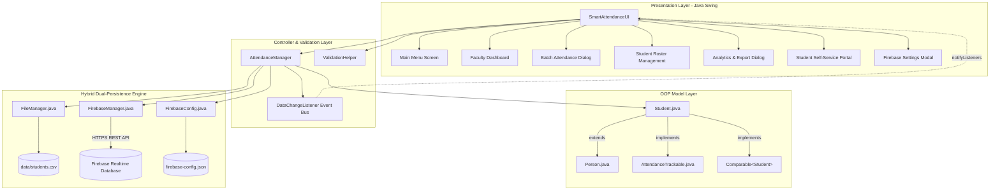
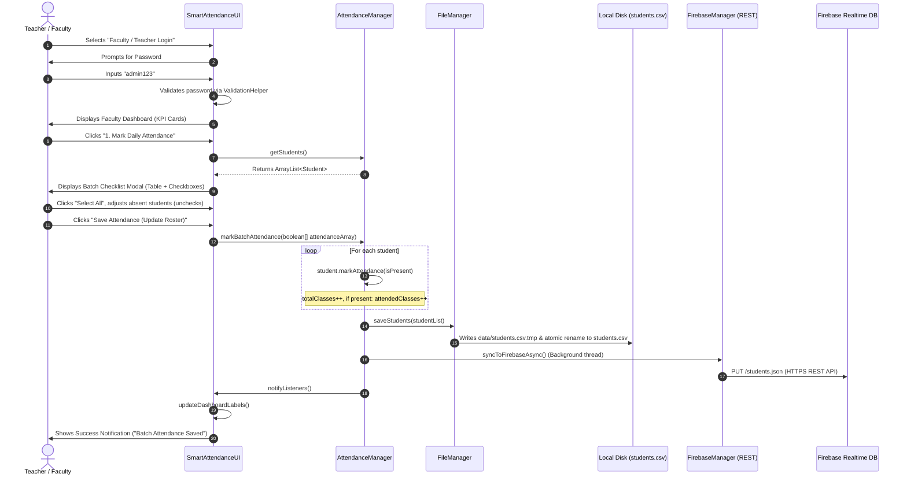
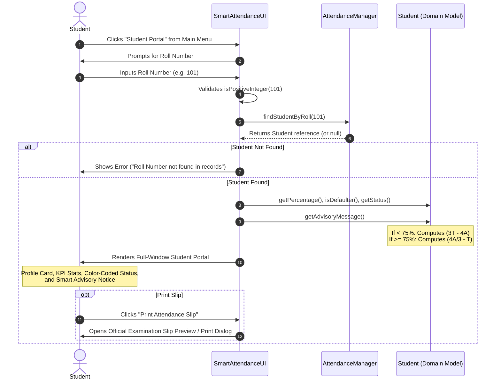
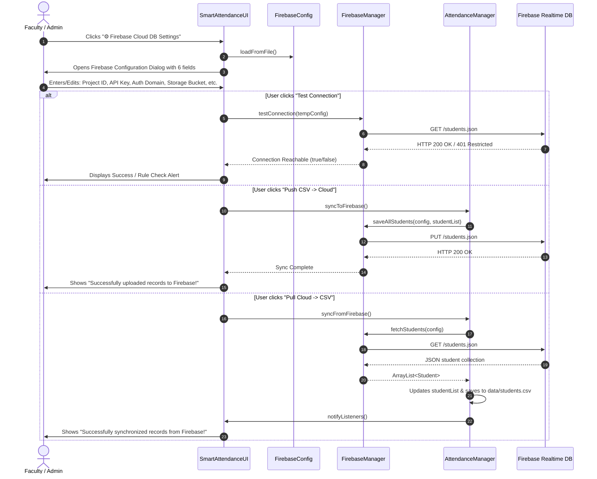
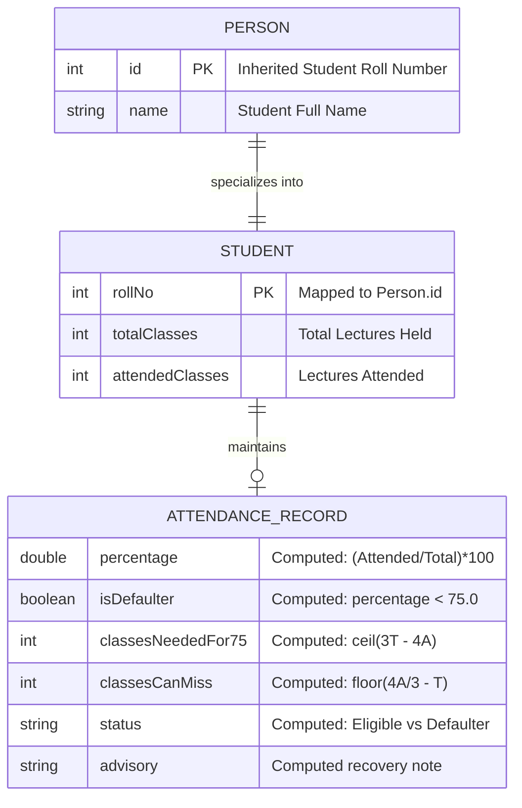

# PROJECT DOCUMENTATION: SMART STUDENT / ATTENDANCE MANAGEMENT SYSTEM

> **System Name:** Smart Attendance Management System (ERP Academic Module)  
> **Institution:** Noida Institute of Engineering and Technology (NIET), Greater Noida  
> **Course/Domain:** Object-Oriented Technologies (Java SE) / Academic Enterprise Resource Planning  
> **Root Directory:** `d:\NIET\LMS\OOT Using  Java\Smart-Attendance-Management-System\`  
> **Main Entry Point:** [`SmartAttendanceUI.java`](file:///d:/NIET/LMS/OOT%20Using%20%20Java/Smart-Attendance-Management-System/SmartAttendanceUI.java)  
> **Documentation Date:** October 2026  

---

## 1. Project Overview

### 1.1 Purpose
The **Smart Attendance Management System** is a standalone desktop ERP module designed to digitize, automate, and streamline academic attendance tracking, real-time university examination eligibility auditing, and institutional reporting. 

### 1.2 Problem It Solves
1. **Paper-Based Inefficiencies & Human Error:** Eliminates paper attendance registers, manual headcount tallies, and error-prone percentage calculations.
2. **Delayed Defaulter Identification:** Prevents end-of-semester surprises where students discover too late that they fall below university mandatory attendance thresholds (e.g., 75%).
3. **Lack of Predictive Student Guidance:** Provides automated, exact mathematical projections telling defaulters how many consecutive lectures they must attend to regain eligibility, and telling safe students how many classes they can afford to miss.
4. **Data Desynchronization & Concurrency Risks:** Solves file corruption risks via atomic temporary file swapping, and provides real-time bidirectional file change detection (auto-sync).
5. **Cloud Transition & Hybrid Resilience:** Bridges offline local file storage (`data/students.csv`) and cloud persistence (Google Firebase Realtime Database) with zero third-party JAR dependencies.

### 1.3 Target Users
- **Faculty / Teachers / Academic Administrators:** Record daily batch attendance, register new students, edit student profiles, monitor class-wide KPI metrics, export official reports to CSV/Excel, print attendance slips, and configure cloud synchronization.
- **Students:** Access a dedicated, full-window self-service portal to view attendance percentages, university exam eligibility status, and advisory recovery notices without needing administrative passwords.
- **Academic Authorities / Exam Cell:** Generate signed, standardized attendance rosters and audit trail reports for compliance.

*(Note: Parent role, timetable scheduling, fee tracking, and marks/results management are **Not found in code**).*

---

## 2. Tech Stack

### 2.1 Core Technologies & Runtime
- **Programming Language:** Java (Java SE)
  - **Source/Target Compatibility:** Java 8 (`JDK 1.8` as configured in [`.idea/misc.xml`](file:///d:/NIET/LMS/OOT%20Using%20%20Java/Smart-Attendance-Management-System/.idea/misc.xml)), fully forward-compatible with Java 11, 17, 21, and 25.
- **GUI Framework:** Java Swing (`javax.swing.*`) and Java AWT (`java.awt.*`)
  - Standalone desktop client rendering native windowing with custom 2D anti-aliased components (`ModernButton`).
- **Database & Persistence:**
  1. **Primary Cloud DB:** Google Firebase Realtime Database (via pure HTTP/1.1 REST API using `java.net.HttpURLConnection`).
  2. **Local Cache / Fallback Storage:** Flat-file Comma-Separated Values ([`data/students.csv`](file:///d:/NIET/LMS/OOT%20Using%20%20Java/Smart-Attendance-Management-System/data/students.csv)) encoded with UTF-8 BOM.
- **Concurrency & Multithreading:**
  - `java.util.concurrent.ExecutorService` (`Executors.newSingleThreadExecutor()`) for non-blocking asynchronous cloud updates.
  - `javax.swing.Timer` for polling background file changes every 2,500 ms.
  - Thread-safe collections: `java.util.concurrent.CopyOnWriteArrayList` for listener registries.
- **Build & Project Configuration:**
  - Standard Java compilation (`javac -encoding UTF-8 *.java`).
  - IntelliJ IDEA Project format ([`Smart-Attendance-Management-System.iml`](file:///d:/NIET/LMS/OOT%20Using%20%20Java/Smart-Attendance-Management-System/Smart-Attendance-Management-System.iml), [`.idea/`](file:///d:/NIET/LMS/OOT%20Using%20%20Java/Smart-Attendance-Management-System/.idea/)).
- **External Dependencies / Package Managers:**
  - **Zero Third-Party JARs / Zero Maven / Zero Gradle.** All networking, JSON parsing, serialization, UI rendering, printing, and file I/O use the standard Java Runtime Environment (JRE) standard library.

---

## 3. Folder Structure

```
d:\NIET\LMS\OOT Using  Java\Smart-Attendance-Management-System\
├── .git/                                    # Git version control metadata
├── .gitignore                               # Excludes *.class, .idea/, *.iml, out/, temp files
├── .idea/                                   # IntelliJ IDEA workspace and compiler configuration
│   ├── misc.xml                             # JDK 1.8 language level definition
│   ├── modules.xml                          # Project module references
│   └── workspace.xml                        # IDE user settings and window states
├── data/                                    # Local persistence data directory
│   └── students.csv                         # Master CSV storage containing student attendance records
├── out/                                     # Compiler output directory (ignored by git)
│   └── production/
│       └── Smart-Attendance-Management-System/ # Compiled JVM bytecode (.class files)
├── AttendanceManager.java                   # Core controller managing data, sorting, filtering & sync
├── AttendanceTrackable.java                 # Interface contract defining attendance auditing behaviors
├── DuplicateStudentException.java           # Checked exception thrown when registering existing roll no
├── FileManager.java                         # File persistence engine (CSV I/O, atomic writes, auto-sync)
├── FirebaseConfig.java                      # Firebase credentials model & json parser/serializer
├── FirebaseManager.java                     # Pure Java REST client for Firebase Realtime Database
├── FINAL_REVIEW_REPORT_AND_PRESENTATION.md  # Comprehensive project report & viva presentation guide
├── InvalidAttendanceDataException.java      # Runtime exception for invalid attendance values
├── Person.java                              # Abstract base entity class demonstrating OOP inheritance
├── Project_Code_Explanation_and_Viva_Guide.pdf # Official project explanation & viva reference document
├── Smart-Attendance-Management-System.iml   # IntelliJ IDEA module descriptor
├── SmartAttendanceUI.java                   # Main entry point & Swing GUI (Dashboard, Batch, Roster, Reports, Student Portal)
├── Student.java                             # Concrete entity subclass implementing AttendanceTrackable & Comparable
├── StudentNotFoundException.java            # Checked exception thrown when roll number is missing
├── ValidationHelper.java                    # Utility class for regex, bounds, password & input validation
└── firebase-config.json                     # Local JSON credentials configuration for Firebase connection
```

---

## 4. System Architecture

### 4.1 Architectural Pattern
The application follows an **Object-Oriented Layered Architecture** with elements of the **Observer Pattern** (event-driven listener notifications):

1. **Presentation Layer (UI):**
   - [`SmartAttendanceUI.java`](file:///d:/NIET/LMS/OOT%20Using%20%20Java/Smart-Attendance-Management-System/SmartAttendanceUI.java): Main entry point, Swing views, dialogs, custom renderers (`ModernButton`, `TableCellRenderer`), and UI event dispatching.
2. **Business Logic & Controller Layer:**
   - [`AttendanceManager.java`](file:///d:/NIET/LMS/OOT%20Using%20%20Java/Smart-Attendance-Management-System/AttendanceManager.java): Synchronized state manager, business rules (filtering, search, statistics, batch operations).
   - [`ValidationHelper.java`](file:///d:/NIET/LMS/OOT%20Using%20%20Java/Smart-Attendance-Management-System/ValidationHelper.java): Input validation, string sanitize checks, range checks.
3. **Domain / Model Layer:**
   - [`Person.java`](file:///d:/NIET/LMS/OOT%20Using%20%20Java/Smart-Attendance-Management-System/Person.java): Abstract base class (`id`, `name`).
   - [`Student.java`](file:///d:/NIET/LMS/OOT%20Using%20%20Java/Smart-Attendance-Management-System/Student.java): Concrete domain model with attendance calculations, comparative logic, and advisory algorithms.
   - [`AttendanceTrackable.java`](file:///d:/NIET/LMS/OOT%20Using%20%20Java/Smart-Attendance-Management-System/AttendanceTrackable.java): Interface declaring contract for tracking.
   - Exception domain: [`DuplicateStudentException.java`](file:///d:/NIET/LMS/OOT%20Using%20%20Java/Smart-Attendance-Management-System/DuplicateStudentException.java), [`StudentNotFoundException.java`](file:///d:/NIET/LMS/OOT%20Using%20%20Java/Smart-Attendance-Management-System/StudentNotFoundException.java), [`InvalidAttendanceDataException.java`](file:///d:/NIET/LMS/OOT%20Using%20%20Java/Smart-Attendance-Management-System/InvalidAttendanceDataException.java).
4. **Data Access & Persistence Layer (Hybrid Dual Storage):**
   - [`FileManager.java`](file:///d:/NIET/LMS/OOT%20Using%20%20Java/Smart-Attendance-Management-System/FileManager.java): Atomic CSV reader/writer, timestamp poller, Excel CSV report builder.
   - [`FirebaseConfig.java`](file:///d:/NIET/LMS/OOT%20Using%20%20Java/Smart-Attendance-Management-System/FirebaseConfig.java): JSON configuration reader/writer.
   - [`FirebaseManager.java`](file:///d:/NIET/LMS/OOT%20Using%20%20Java/Smart-Attendance-Management-System/FirebaseManager.java): Native HTTP client executing REST calls against Google Firebase.

### 4.2 Architecture Diagram



---

## 5. User Roles & Permissions

| Role | Authentication Mechanism | Permissions / Accessible Features | Restrictions |
| :--- | :--- | :--- | :--- |
| **Faculty / Teacher / Admin** | Password prompt (`admin123`) validated via [`ValidationHelper.checkPassword`](file:///d:/NIET/LMS/OOT%20Using%20%20Java/Smart-Attendance-Management-System/ValidationHelper.java#L61) | <ul><li>Access Faculty Dashboard</li><li>Mark batch attendance (select all, invert, toggle present/absent)</li><li>Register new student records with roll numbers</li><li>Edit student names, total lectures, and attended counts</li><li>Delete student records with confirmation</li><li>View and filter defaulters ($<75\%$) and eligible ($ \ge 75\%$) rosters</li><li>Sort roster by Roll No, Name, and Attendance %</li><li>Export full official reports to Excel CSV with UTF-8 BOM</li><li>Print attendance rosters to physical/virtual printers</li><li>Configure Firebase credentials, push local CSV to cloud, pull cloud data to local</li></ul> | Must provide valid admin password. |
| **Student** | Roll Number lookup (e.g., `101`, `105`) validated via [`ValidationHelper.isPositiveInteger`](file:///d:/NIET/LMS/OOT%20Using%20%20Java/Smart-Attendance-Management-System/ValidationHelper.java#L5) | <ul><li>Access full-window Student Portal</li><li>View personal total classes held, attended classes, and percentage</li><li>View real-time Exam Eligibility Status Badge (`Safe Zone` vs `Critical Defaulter`)</li><li>View personalized smart advisory note (consecutive classes needed vs affordable classes to miss)</li><li>Print official NIET examination verification slip</li><li>Switch roll numbers to view another account</li></ul> | **Read-only access.** Cannot modify attendance counts, cannot add or delete students, cannot access faculty dashboard or Firebase settings. |
| **Parent** | *Not found in code* | *Not found in code* | N/A |

---

## 6. Features & Modules

| Feature / Module | Purpose & Functional Description | Relevant Files | Status |
| :--- | :--- | :--- | :--- |
| **Faculty Authentication** | Modal password prompt guarding administrative screens. Password verified against static constant. | [`SmartAttendanceUI.java`](file:///d:/NIET/LMS/OOT%20Using%20%20Java/Smart-Attendance-Management-System/SmartAttendanceUI.java#L294-L314), [`ValidationHelper.java`](file:///d:/NIET/LMS/OOT%20Using%20%20Java/Smart-Attendance-Management-System/ValidationHelper.java#L61-L66) | **Complete** |
| **Faculty KPI Dashboard** | Displays real-time metric cards (Total Enrolled, Exam Eligible $\ge 75\%$, Critical Defaulters $< 75\%$, Batch Average Attendance) and 2x2 action grid. | [`SmartAttendanceUI.java`](file:///d:/NIET/LMS/OOT%20Using%20%20Java/Smart-Attendance-Management-System/SmartAttendanceUI.java#L393-L510), [`AttendanceManager.java`](file:///d:/NIET/LMS/OOT%20Using%20%20Java/Smart-Attendance-Management-System/AttendanceManager.java#L238-L265) | **Complete** |
| **Batch Attendance Checklist** | Single-window checklist table with checkbox per student. Fast actions: "Select All", "Clear All", "Invert Selection". Computes live Present/Absent tallies and updates all records in one batch save. | [`SmartAttendanceUI.java`](file:///d:/NIET/LMS/OOT%20Using%20%20Java/Smart-Attendance-Management-System/SmartAttendanceUI.java#L841-L1099), [`AttendanceManager.java`](file:///d:/NIET/LMS/OOT%20Using%20%20Java/Smart-Attendance-Management-System/AttendanceManager.java#L175-L188) | **Complete** |
| **Student Roster Management** | Table view displaying all enrolled students. Supports adding new students, editing records, and deleting records with confirmation. | [`SmartAttendanceUI.java`](file:///d:/NIET/LMS/OOT%20Using%20%20Java/Smart-Attendance-Management-System/SmartAttendanceUI.java#L1101-L1426), [`AttendanceManager.java`](file:///d:/NIET/LMS/OOT%20Using%20%20Java/Smart-Attendance-Management-System/AttendanceManager.java#L47-L150) | **Complete** |
| **Exception Handling & Validation** | Validates inputs (non-negative integers, attended $\le$ total, letters in names, positive roll numbers) and throws checked/unchecked domain exceptions. | [`ValidationHelper.java`](file:///d:/NIET/LMS/OOT%20Using%20%20Java/Smart-Attendance-Management-System/ValidationHelper.java), [`DuplicateStudentException.java`](file:///d:/NIET/LMS/OOT%20Using%20%20Java/Smart-Attendance-Management-System/DuplicateStudentException.java), [`InvalidAttendanceDataException.java`](file:///d:/NIET/LMS/OOT%20Using%20%20Java/Smart-Attendance-Management-System/InvalidAttendanceDataException.java), [`StudentNotFoundException.java`](file:///d:/NIET/LMS/OOT%20Using%20%20Java/Smart-Attendance-Management-System/StudentNotFoundException.java) | **Complete** |
| **Search, Filter & Sorting** | Real-time text search query matching roll number or name substrings. Dropdown filters for Defaulter/Eligible. Sorting via `Comparable` and `Comparator`. | [`SmartAttendanceUI.java`](file:///d:/NIET/LMS/OOT%20Using%20%20Java/Smart-Attendance-Management-System/SmartAttendanceUI.java#L1428-L1764), [`AttendanceManager.java`](file:///d:/NIET/LMS/OOT%20Using%20%20Java/Smart-Attendance-Management-System/AttendanceManager.java#L161-L173), [`Student.java`](file:///d:/NIET/LMS/OOT%20Using%20%20Java/Smart-Attendance-Management-System/Student.java#L125-L128) | **Complete** |
| **Excel-Compatible CSV Export** | Generates institutional CSV files containing NIET letterhead, timestamp, summary metrics, and escaped fields prefixed with `\uFEFF` UTF-8 BOM. | [`FileManager.java`](file:///d:/NIET/LMS/OOT%20Using%20%20Java/Smart-Attendance-Management-System/FileManager.java#L117-L181) | **Complete** |
| **Direct Hardware Printing** | Native print pipeline triggering OS print dialog with institutional header and page numbers via `JTable.print()`. | [`SmartAttendanceUI.java`](file:///d:/NIET/LMS/OOT%20Using%20%20Java/Smart-Attendance-Management-System/SmartAttendanceUI.java#L1730-L1746) | **Complete** |
| **Student Self-Service Portal** | Full-window interface showing percentage, color-coded status, recovery advisory notes, and examination slip print preview. | [`SmartAttendanceUI.java`](file:///d:/NIET/LMS/OOT%20Using%20%20Java/Smart-Attendance-Management-System/SmartAttendanceUI.java#L1766-L1982), [`Student.java`](file:///d:/NIET/LMS/OOT%20Using%20%20Java/Smart-Attendance-Management-System/Student.java#L62-L95) | **Complete** |
| **Bidirectional CSV Auto-Sync** | Background timer polls disk timestamp every 2.5 seconds. If external program modifies CSV, automatically reloads memory model. | [`SmartAttendanceUI.java`](file:///d:/NIET/LMS/OOT%20Using%20%20Java/Smart-Attendance-Management-System/SmartAttendanceUI.java#L85-L93), [`AttendanceManager.java`](file:///d:/NIET/LMS/OOT%20Using%20%20Java/Smart-Attendance-Management-System/AttendanceManager.java#L296-L307), [`FileManager.java`](file:///d:/NIET/LMS/OOT%20Using%20%20Java/Smart-Attendance-Management-System/FileManager.java#L105-L115) | **Complete** |
| **Firebase Cloud DB REST Module** | Connects to Google Firebase Realtime Database via HTTP REST API. Features GUI configuration, connectivity test, manual push/pull, and auto-sync. | [`FirebaseConfig.java`](file:///d:/NIET/LMS/OOT%20Using%20%20Java/Smart-Attendance-Management-System/FirebaseConfig.java), [`FirebaseManager.java`](file:///d:/NIET/LMS/OOT%20Using%20%20Java/Smart-Attendance-Management-System/FirebaseManager.java), [`SmartAttendanceUI.java`](file:///d:/NIET/LMS/OOT%20Using%20%20Java/Smart-Attendance-Management-System/SmartAttendanceUI.java#L512-L839) | **Complete** |
| **Timetable / Schedule Module** | Class routine or timetable management | *Not found in code* | **Not found in code** |
| **Fees & Accounting Module** | Student fee collection, receipts, dues | *Not found in code* | **Not found in code** |
| **Marks & Examinations Module** | Subject gradebook, test scores, GPA | *Not found in code* | **Not found in code** |
| **Notice Board / Circulars** | Digital announcements or campus bulletin | *Not found in code* | **Not found in code** |

---

## 7. Complete Workflows

### 7.1 Faculty: Daily Lecture Batch Attendance Workflow



---

### 7.2 Student: Attendance & Eligibility Verification Workflow



---

### 7.3 Faculty: Firebase Cloud Database Configuration & Sync Workflow



---

## 8. Database Design

### 8.1 Data Entities & Storage Models

The system employs a **dual persistence schema**:
1. **Local CSV Storage:** Tabular format stored at [`data/students.csv`](file:///d:/NIET/LMS/OOT%20Using%20%20Java/Smart-Attendance-Management-System/data/students.csv).
2. **Cloud JSON Tree:** Hierarchical document model stored in Google Firebase Realtime Database at root `/students/`.

#### Field Definitions & Data Dictionary

| Field Name | CSV Header | JSON Key | Data Type | Constraints | Description |
| :--- | :--- | :--- | :--- | :--- | :--- |
| **Roll Number** | `RollNo` | `rollNo` | Integer (`int`) | Primary Key, $> 0$, Unique | University student roll number |
| **Student Name** | `Name` | `name` | String (`String`) | Not null, length $\ge 2$, must contain letters | Full name of the student |
| **Total Classes** | `TotalClasses` | `totalClasses` | Integer (`int`) | $\ge 0$, $\ge \text{attendedClasses}$ | Total lectures held for this student |
| **Attended Classes** | `AttendedClasses` | `attendedClasses` | Integer (`int`) | $\ge 0$, $\le \text{totalClasses}$ | Total lectures physically attended |
| *Calculated: Percentage* | *N/A (Computed)* | *N/A* | Double (`double`) | $0.0$ to $100.0$ | $(attendedClasses / totalClasses) \times 100$ |
| *Calculated: Defaulter* | *N/A (Computed)* | *N/A* | Boolean (`boolean`) | `true` if $\% < 75.0$ and $T > 0$ | Flag indicating exam disqualification risk |

### 8.2 Entity Relationship Diagram (ERD) & Firebase JSON Schema



#### Firebase Realtime Database JSON Structure
```json
{
  "students": {
    "101": {
      "rollNo": 101,
      "name": "Aarav Sharma",
      "totalClasses": 26,
      "attendedClasses": 23
    },
    "102": {
      "rollNo": 102,
      "name": "Priya Singh",
      "totalClasses": 26,
      "attendedClasses": 18
    }
  }
}
```

---

## 9. API Endpoints (Firebase REST Client)

The application communicates with Google Firebase Realtime Database through pure Java HTTP REST endpoints implemented in [`FirebaseManager.java`](file:///d:/NIET/LMS/OOT%20Using%20%20Java/Smart-Attendance-Management-System/FirebaseManager.java):

| HTTP Method | Endpoint URL / Route | Purpose | Request Body | Response Body | Auth Required | Defined In File |
| :---: | :--- | :--- | :--- | :--- | :---: | :--- |
| `GET` | `https://<projectId>-default-rtdb.firebaseio.com/students.json` | Test connection / Ping server | *None* | JSON object or `null` | Optional (`?auth=token` if rules require it) | [`FirebaseManager.java:23`](file:///d:/NIET/LMS/OOT%20Using%20%20Java/Smart-Attendance-Management-System/FirebaseManager.java#L23) |
| `GET` | `https://<projectId>-default-rtdb.firebaseio.com/students.json` | Fetch all student attendance records | *None* | Key-value JSON map of student objects: `{"101": {...}, "102": {...}}` | Optional (`?auth=token`) | [`FirebaseManager.java:50`](file:///d:/NIET/LMS/OOT%20Using%20%20Java/Smart-Attendance-Management-System/FirebaseManager.java#L50) |
| `PUT` | `https://<projectId>-default-rtdb.firebaseio.com/students.json` | Upload & overwrite entire student roster | Full JSON string map of all student records | `{"101": {...}, ...}` (echoed back on HTTP 200) | Optional (`?auth=token`) | [`FirebaseManager.java:80`](file:///d:/NIET/LMS/OOT%20Using%20%20Java/Smart-Attendance-Management-System/FirebaseManager.java#L80) |
| `PUT` | `https://<projectId>-default-rtdb.firebaseio.com/students/<rollNo>.json` | Upsert single student record | Single student JSON object: `{"rollNo": 101, "name": "...", "totalClasses": 26, "attendedClasses": 23}` | Updated student JSON object | Optional (`?auth=token`) | [`FirebaseManager.java:107`](file:///d:/NIET/LMS/OOT%20Using%20%20Java/Smart-Attendance-Management-System/FirebaseManager.java#L107) |
| `DELETE` | `https://<projectId>-default-rtdb.firebaseio.com/students/<rollNo>.json` | Delete single student by roll number | *None* | `null` on HTTP 200 | Optional (`?auth=token`) | [`FirebaseManager.java:134`](file:///d:/NIET/LMS/OOT%20Using%20%20Java/Smart-Attendance-Management-System/FirebaseManager.java#L134) |

*(Note: Internal REST/Spring web controllers or backend HTTP servers are **Not found in code**; this is a desktop client consuming external cloud APIs).*

---

## 10. Authentication & Security

### 10.1 Authentication Mechanisms
1. **Faculty / Admin Authentication:**
   - Mechanism: Static password prompt rendered via `JOptionPane.showConfirmDialog`.
   - Hardcoded Password: `admin123` defined at [`SmartAttendanceUI.java:50`](file:///d:/NIET/LMS/OOT%20Using%20%20Java/Smart-Attendance-Management-System/SmartAttendanceUI.java#L50).
   - Comparison: Direct string equality check in [`ValidationHelper.checkPassword(entered, expected)`](file:///d:/NIET/LMS/OOT%20Using%20%20Java/Smart-Attendance-Management-System/ValidationHelper.java#L61-L66).
2. **Student Authentication:**
   - Mechanism: Identification by unique Roll Number. No password or PIN required.
   - Guarded by [`ValidationHelper.isPositiveInteger()`](file:///d:/NIET/LMS/OOT%20Using%20%20Java/Smart-Attendance-Management-System/ValidationHelper.java#L5-L15) and record existence check.

### 10.2 Security Weaknesses & Vulnerabilities
1. **Hardcoded Plaintext Administrative Password:**
   - The password `admin123` is stored as a plaintext `String` constant in source code, easily readable by decompiler (`javap` / CFR) or inspecting source files.
   - *Recommendation:* Transition to salted hashing (e.g., Argon2, bcrypt, or PBKDF2) stored in a secure credential store or OS keychain.
2. **Lack of Student Authentication Credentials:**
   - Any person who enters a valid integer roll number (e.g., 101, 102) can view that student's attendance percentage, status, and print slips.
   - *Recommendation:* Introduce student passwords, date-of-birth verification, or institutional SSO (OAuth 2.0 / Google Workspace).
3. **Open Firebase Realtime Database Rules Risk:**
   - For public test mode, Firebase rules are often configured as `{ ".read": true, ".write": true }`. Without authentication rules, anyone possessing the `projectId` can query or overwrite the entire student database.
   - *Recommendation:* Implement Firebase Authentication tokens or Realtime Database secret tokens passed via `?auth=`.
4. **Local File Exposure:**
   - `data/students.csv` and `firebase-config.json` are stored unencrypted on disk. Local users can edit or delete them.

---

## 11. Frontend Pages & Screens

All screens are built using Java Swing within [`SmartAttendanceUI.java`](file:///d:/NIET/LMS/OOT%20Using%20%20Java/Smart-Attendance-Management-System/SmartAttendanceUI.java):

### 11.1 Screen 1: Main Menu / Landing Screen
- **Method:** [`showMainMenu()`](file:///d:/NIET/LMS/OOT%20Using%20%20Java/Smart-Attendance-Management-System/SmartAttendanceUI.java#L243)
- **UI Elements:**
  - Header: NIET banner in `#0F172A` with bold white title and `#BAE6FD` subtitle.
  - Centered Action Card containing 3 modern buttons:
    1. **"Faculty / Teacher Login"** (Royal Blue `#1D4ED8`) $\rightarrow$ triggers `handleTeacherLogin()`.
    2. **"Student Portal"** (Teal `#0E7490`) $\rightarrow$ triggers `showStudentLogin()`.
    3. **"Exit System"** (Crimson `#DC2626`) $\rightarrow$ terminates auto-sync timer and exits JVM.

### 11.2 Screen 2: Faculty / Admin Dashboard
- **Method:** [`showTeacherDashboard()`](file:///d:/NIET/LMS/OOT%20Using%20%20Java/Smart-Attendance-Management-System/SmartAttendanceUI.java#L393)
- **UI Elements:**
  - **Top Bar:** Institution title, current academic session (`2026-27`), live date timestamp, `Firebase Status Badge` (color-coded green if configured, amber if local), and `Logout` button.
  - **KPI Metric Strip (4 Cards):**
    1. *Total Enrolled:* Total students registered.
    2. *Exam Eligible ($\ge 75\%$):* Count of students in safe zone (Green `#16A34A`).
    3. *Critical Defaulters ($< 75\%$):* Count of at-risk students (Red `#DC2626`).
    4. *Batch Average:* Overall percentage of lectures attended across class.
  - **2x2 Feature Grid:**
    1. *Card 1 (Batch Attendance):* "1. Mark Daily Attendance" $\rightarrow$ opens `showBatchAttendanceDialog()`.
    2. *Card 2 (Student Records):* "2. Manage Students Roster" $\rightarrow$ opens `showManageStudentsDialog()`.
    3. *Card 3 (Analytics & Export):* "3. View Full Reports & Print" $\rightarrow$ opens `showReportsDialog(false)`.
    4. *Card 4 (Critical Alerts):* "4. View Defaulters List (< 75%)" $\rightarrow$ opens `showReportsDialog(true)`.
  - **Footer:** Storage indicator (`data/students.csv` or `Firebase Cloud DB`) + `⚙ Firebase Cloud DB Settings` button.

### 11.3 Screen 3: Mark Daily Attendance (Batch Checklist Modal)
- **Method:** [`showBatchAttendanceDialog()`](file:///d:/NIET/LMS/OOT%20Using%20%20Java/Smart-Attendance-Management-System/SmartAttendanceUI.java#L841)
- **UI Elements:**
  - Non-modal / Modal dialog with batch header and summary count.
  - **Batch Control Panel:**
    - Button: "Select All (Present)"
    - Button: "Clear All (Absent)"
    - Button: "Invert Selection"
    - Live Counters: "Present: X / Y", "Absent: Z / Y"
  - **JTable with JCheckBox renderer:** Roll No, Student Name, Current Attendance, Today's Present Checkbox.
  - Bottom bar: "Save Attendance (Update Roster)" and "Cancel".

### 11.4 Screen 4: Manage Student Roster Modal
- **Method:** [`showManageStudentsDialog()`](file:///d:/NIET/LMS/OOT%20Using%20%20Java/Smart-Attendance-Management-System/SmartAttendanceUI.java#L1101)
- **UI Elements:**
  - Full editable table showing Roll No, Name, Total Held, Attended, Attendance %, and Status.
  - Action buttons:
    - **"Register New Student"** $\rightarrow$ opens `showAddStudentInline()` modal.
    - **"Edit Selected Record"** $\rightarrow$ opens `showEditStudentDialog()` modal.
    - **"Delete Selected Record"** $\rightarrow$ removes student with confirmation.
    - **"Close"**.

### 11.5 Screen 5: Analytics, Reports & Export Modal
- **Method:** [`showReportsDialog(boolean initialDefaulterOnly)`](file:///d:/NIET/LMS/OOT%20Using%20%20Java/Smart-Attendance-Management-System/SmartAttendanceUI.java#L1428)
- **UI Elements:**
  - Filter Bar: Live Search text field + Filter dropdown ("All Students", "Eligible Only", "Defaulters Only") + Sort dropdown ("Roll No", "Name A-Z", "Attendance % High-to-Low", "Attendance % Low-to-High").
  - Table: Permanently dark headers (`#0F172A`), white bold text, alternating row fills.
  - Bottom Actions:
    - **"Export to Excel (.csv)"** $\rightarrow$ file chooser saving formatted report with UTF-8 BOM.
    - **"Print Official Report"** $\rightarrow$ native Java print service with headers.
    - **"Close"**.

### 11.6 Screen 6: Student Self-Service Portal
- **Method:** [`showStudentDashboard(Student s)`](file:///d:/NIET/LMS/OOT%20Using%20%20Java/Smart-Attendance-Management-System/SmartAttendanceUI.java#L1797)
- **UI Elements:**
  - **Student Profile Card:** Roll number, student full name, NIET academic session.
  - **Metrics Row (3 Cards):** Total Classes Held, Classes Attended, Attendance Percentage (large bold 28pt font with green/red indicator).
  - **Eligibility & Smart Advisory Card:**
    - If Defaulter: Red warning badge with exact count of consecutive classes required.
    - If Eligible: Green safe badge with count of classes affordable to miss.
  - **Action Row:**
    - "Print Official Attendance Verification Slip"
    - "Switch Student Account"
    - "Back to Main Menu"

### 11.7 Screen 7: Firebase Cloud Database Settings Modal
- **Method:** [`showFirebaseConfigDialog()`](file:///d:/NIET/LMS/OOT%20Using%20%20Java/Smart-Attendance-Management-System/SmartAttendanceUI.java#L512)
- **UI Elements:**
  - Form Fields for 6 Console credentials + Realtime DB URL + Auth token.
  - Live status indicator (Active vs Local mode).
  - Actions: "Test Connection", "Push CSV to Cloud", "Pull Cloud to CSV", "Save Configuration", "Clear / Revert", "Close".

---

## 12. Business Logic & "Smart" Features

### 12.1 Attendance Percentage & Zero-Class Edge Case Guard
Defined in [`Student.java:38-43`](file:///d:/NIET/LMS/OOT%20Using%20%20Java/Smart-Attendance-Management-System/Student.java#L38-L43):
$$\text{Percentage} = \begin{cases} 0.0, & \text{if } \text{totalClasses} \le 0 \\ \left(\frac{\text{attendedClasses}}{\text{totalClasses}}\right) \times 100.0, & \text{otherwise} \end{cases}$$
- **Edge Case Protection:** When a new student is admitted or a new semester begins where $\text{totalClasses} == 0$, [`isDefaulter()`](file:///d:/NIET/LMS/OOT%20Using%20%20Java/Smart-Attendance-Management-System/Student.java#L46-L51) returns `false` and status displays `"No Classes Held"`, preventing unfair defaulter flagging.

### 12.2 University Examination Eligibility Threshold
- **Threshold Rule:** Attendance $\ge 75.0\%$ is required to appear in semester examinations.
- Defaulter condition: $\text{totalClasses} > 0 \land \text{percentage} < 75.0$.

### 12.3 Smart Mathematical Recovery Projection (Defaulter Recovery)
Defined in [`Student.java:62-68`](file:///d:/NIET/LMS/OOT%20Using%20%20Java/Smart-Attendance-Management-System/Student.java#L62-L68):
For a student currently below $75\%$, how many consecutive upcoming lectures $x$ must they attend to bring their overall attendance back to $75\%$?
$$\frac{A + x}{T + x} \ge 0.75 \implies 4(A + x) \ge 3(T + x) \implies 4A + 4x \ge 3T + 3x \implies x \ge 3T - 4A$$
$$\text{classesNeeded} = \max\left(1, \left\lceil 3 \cdot \text{totalClasses} - 4 \cdot \text{attendedClasses} \right\rceil\right)$$
The system automatically generates the dynamic advisory:
`"Need to attend next X consecutive classes to reach 75%."`

### 12.4 Safe Zone Margin Projection (Affordable Bunk Calculator)
Defined in [`Student.java:71-77`](file:///d:/NIET/LMS/OOT%20Using%20%20Java/Smart-Attendance-Management-System/Student.java#L71-L77):
For a student in the safe zone ($\ge 75\%$), how many future lectures $y$ can they miss without falling below $75\%$?
$$\frac{A}{T + y} \ge 0.75 \implies 4A \ge 3(T + y) \implies 3y \le 4A - 3T \implies y \le \frac{4A}{3} - T$$
$$\text{classesCanMiss} = \max\left(0, \left\lfloor \frac{4 \cdot \text{attendedClasses}}{3} - \text{totalClasses} \right\rfloor\right)$$
The system automatically generates the dynamic advisory:
`"Safe Zone: Can afford to miss up to Y classes."`

### 12.5 Atomic CSV Persistence Engine
Defined in [`FileManager.java:71-103`](file:///d:/NIET/LMS/OOT%20Using%20%20Java/Smart-Attendance-Management-System/FileManager.java#L71-L103):
- Instead of writing directly to `data/students.csv` (which risks total data loss if the system terminates mid-write), the system writes to `data/students.csv.tmp`.
- Only after `pw.flush()` completes without exception is the existing file replaced using atomic file rename (`tempFile.renameTo(file)`).

### 12.6 Live Disk File Change Detection (Auto-Sync Polling)
Defined in [`FileManager.java:105-110`](file:///d:/NIET/LMS/OOT%20Using%20%20Java/Smart-Attendance-Management-System/FileManager.java#L105-L110) & [`SmartAttendanceUI.java:85-93`](file:///d:/NIET/LMS/OOT%20Using%20%20Java/Smart-Attendance-Management-System/SmartAttendanceUI.java#L85-L93):
- The static variable `lastKnownModified` tracks file write timestamps.
- A 2.5-second timer checks `file.lastModified() > lastKnownModified`.
- If an administrator modifies `data/students.csv` via Notepad, Excel, or another tool, the application automatically reloads the roster into memory and updates GUI labels.

---

## 13. Third-Party Integrations

| Service / Integration | Protocol / Tech | Purpose & Usage in Code | Status |
| :--- | :--- | :--- | :--- |
| **Google Firebase Realtime Database** | HTTPS REST API via `HttpURLConnection` | Cloud backup, synchronization, and multi-device persistence ([`FirebaseManager.java`](file:///d:/NIET/LMS/OOT%20Using%20%20Java/Smart-Attendance-Management-System/FirebaseManager.java)). | **Active / Functional** |
| **Java Print Service (`javax.print`)** | Native Java 2D Graphics Print API | Physical printer output & "Microsoft Print to PDF" slip generation ([`SmartAttendanceUI.java:1730`](file:///d:/NIET/LMS/OOT%20Using%20%20Java/Smart-Attendance-Management-System/SmartAttendanceUI.java#L1730)). | **Active / Functional** |
| **Excel CSV Export** | Standard CSV with `\uFEFF` UTF-8 BOM | Formatted report export readable by Microsoft Excel, LibreOffice Calc, and Google Sheets. | **Active / Functional** |
| **Email Gateway (SMTP / SendGrid)** | N/A | *Not found in code* | **Not found in code** |
| **SMS Gateway (Twilio / Fast2SMS)** | N/A | *Not found in code* | **Not found in code** |
| **Payment Gateway (Razorpay / Stripe)**| N/A | *Not found in code* | **Not found in code** |
| **Cloud Storage (AWS S3 / GCS)** | N/A | *Not found in code* | **Not found in code** |

---

## 14. Configuration & Environment

The application does not use system environment variables (`System.getenv`). Instead, configuration is handled via local files and static code constants:

### 14.1 Configuration File: `firebase-config.json`
Location: Project root [`firebase-config.json`](file:///d:/NIET/LMS/OOT%20Using%20%20Java/Smart-Attendance-Management-System/firebase-config.json)

| Property Name | Required? | Example Description |
| :--- | :---: | :--- |
| `apiKey` | Yes | Firebase Web API Key from Firebase Console |
| `authDomain` | Optional | Firebase Auth Domain (e.g., `<project-id>.firebaseapp.com`) |
| `projectId` | Yes | Unique Google Cloud / Firebase Project Identifier |
| `storageBucket` | Optional | Cloud Storage Bucket (e.g., `<project-id>.appspot.com`) |
| `messagingSenderId`| Optional | Numeric Cloud Messaging Sender Identifier |
| `appId` | Optional | Unique Web App Identifier (e.g., `1:123456:web:...`) |
| `databaseUrl` | Yes | Realtime Database URL (default: `https://<projectId>-default-rtdb.firebaseio.com`) |
| `authToken` | Optional | Database Secret or Auth ID Token for restricted database rules |

### 14.2 Code Constants
- `TEACHER_PASSWORD`: [`SmartAttendanceUI.java:50`](file:///d:/NIET/LMS/OOT%20Using%20%20Java/Smart-Attendance-Management-System/SmartAttendanceUI.java#L50) $\rightarrow$ Default: `"admin123"`
- `DEFAULT_FILE_PATH`: [`FileManager.java:15`](file:///d:/NIET/LMS/OOT%20Using%20%20Java/Smart-Attendance-Management-System/FileManager.java#L15) $\rightarrow$ Default: `"data/students.csv"`
- Polling Interval: [`SmartAttendanceUI.java:86`](file:///d:/NIET/LMS/OOT%20Using%20%20Java/Smart-Attendance-Management-System/SmartAttendanceUI.java#L86) $\rightarrow$ Default: `2500` ms

---

## 15. How to Run Locally

### Prerequisites
- Java Development Kit (JDK 8, 11, 17, 21, or 25 installed and on `PATH`).
- Verify installation:
  ```powershell
  javac -version
  java -version
  ```

### Step 1: Clone or Navigate to Project Directory
```powershell
cd "d:\NIET\LMS\OOT Using  Java\Smart-Attendance-Management-System"
```

### Step 2: Compile the Java Source Code
You can compile cleanly into the `out/production` directory or directly in place:
```powershell
# Recommended: Compile into IntelliJ-compatible build directory
javac -encoding UTF-8 -d out/production/Smart-Attendance-Management-System *.java
```

### Step 3: Run the Application
Launch the application:
```powershell
java -cp out/production/Smart-Attendance-Management-System SmartAttendanceUI
```

### Step 4: Seed Data
The system automatically creates [`data/students.csv`](file:///d:/NIET/LMS/OOT%20Using%20%20Java/Smart-Attendance-Management-System/data/students.csv) with default mock students if the file does not exist on disk (see [`FileManager.createDefaultFile()`](file:///d:/NIET/LMS/OOT%20Using%20%20Java/Smart-Attendance-Management-System/FileManager.java#L211-L232)).

---

## 16. Known Issues, Gaps & Security Observations

1. **Plaintext Password in Memory & Source Code:**
   - Password `"admin123"` is hardcoded at [`SmartAttendanceUI.java:50`](file:///d:/NIET/LMS/OOT%20Using%20%20Java/Smart-Attendance-Management-System/SmartAttendanceUI.java#L50).
2. **Student Authentication Gap:**
   - No password, PIN, or multi-factor authentication is required for students. Anyone with a known roll number can view attendance records.
3. **Regex-Based JSON Parser in `FirebaseManager.java`:**
   - [`FirebaseManager.parseStudentsJson()`](file:///d:/NIET/LMS/OOT%20Using%20%20Java/Smart-Attendance-Management-System/FirebaseManager.java#L200-L242) uses regular expressions to extract JSON tokens rather than an AST-based JSON parser. If student names contain escaped quotes or unescaped braces, parsing may fail.
4. **Desktop Single-User Concurrency:**
   - If two faculty members run the application simultaneously on separate computers without Firebase, changes made on one machine will overwrite changes made on the other machine upon file save.
5. **Missing ERP Modules:**
   - Marks, fees, timetable, library, and parent portals are not implemented (*Not found in code*).

---

## 17. Improvement Roadmap

### Priority 1: High (Security & Integrity)
- [ ] **Hash Administrator Password:** Replace `admin123` with PBKDF2/bcrypt hashing stored in an external configuration or secure credential store.
- [ ] **Student PIN / Password System:** Allow students to create a 4-digit PIN or password to secure their attendance records.
- [ ] **Firebase Security Rules:** Configure Firebase Realtime Database security rules with Firebase Auth tokens instead of open test rules.

### Priority 2: Medium (Functional & Cloud Capabilities)
- [ ] **Date-Wise Attendance History:** Currently, the system stores aggregate counts (`totalClasses`, `attendedClasses`). Extend schema to record specific session dates (e.g. `2026-10-22: Present`) to enable monthly attendance calendars.
- [ ] **Subject-Wise Tracking:** Support multiple academic subjects (e.g., Java, Data Structures, Operating Systems) per student rather than a single aggregate counter.
- [ ] **Automated Low-Attendance Email/SMS Alerts:** Integrate JavaMail (SMTP) or SMS gateway (Twilio) to automatically dispatch notification alerts to students and guardians when attendance drops below 75%.

### Priority 3: Low (UX & Quality of Life)
- [ ] **CSV Import Wizard:** Allow teachers to bulk-import class rosters from university Excel sheets (.xlsx / .csv).
- [ ] **Dark Mode / Light Mode Toggle:** Add a theme switch in the Faculty Dashboard.
- [ ] **Lightweight JSON Parser:** Replace regex JSON extraction with a lightweight, standalone zero-dependency JSON tokenizer to handle arbitrary Unicode characters in student names.

---

*Documentation compiled and verified against the actual repository source code.*
